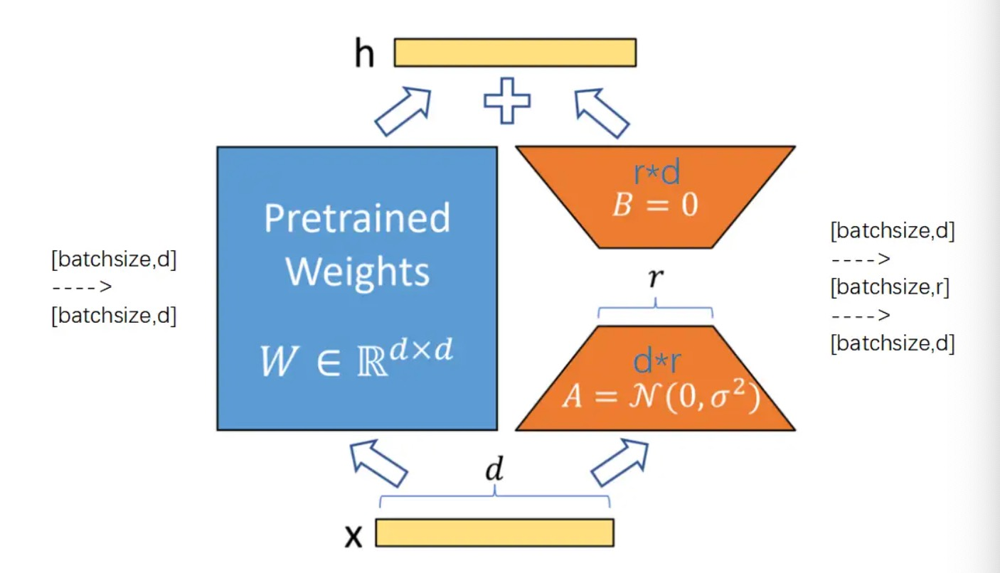

# 1  LoRA + QLoRA 原理



- LoRA 的思路原理

  - 1  **结构设计**：将原全连接层中形状为 $[d, d]$ 的权重矩阵 $W_0$（训练时保持冻结），LoRA 在其旁路引入低秩分解结构。旁路由两个小矩阵组成：降维矩阵 $A$（形状为 $[d, r]$）和升维矩阵 $B$（形状为 $[r, d]$），其中秩 $r \ll d$。

  - 2  **前向计算**：对于形状为 $[B, d]$ 的输入矩阵 $X$：

    - 2.1  主路直接计算：$h_{base} = X \times W_0$，输出形状为 $[B, d]$；

    - 2.2  旁路依次计算：先经矩阵 $A$ 降维为 $[B, r]$，再经矩阵 $B$ 升维恢复为 $[B, d]$，即 $h_{lora} = X \times A \times B$。

  - 3  **结果融合**：将主干输出与带有缩放系数的旁路输出按位相加，得到最终输出：

    - $h = X W_0 + \frac{\alpha}{r} (X A B)$

  - 4  最终形状仍为 $[B, d]$。在推理部署时，也可以直接将权重合并为 $W = W_0 + \frac{\alpha}{r} (A B)$，完全不增加额外推理延迟。

- QLoRA 的技术原理

  - 核心定位：QLoRA 是 LoRA 的高显存效率演进版，核心思想是“冻结的基座权重用 4-bit 存，可训的 LoRA 旁路用 16-bit 训”。

  - **NF4 数据类型**：将原模型参数量化为信息理论上对正态分布最优的 4-bit NormalFloat（NF4），把冻结权重显存直接降低约 75%。

  - 计算流程：输入特征 $X$ 保持 16-bit（BF16/FP16）精度。采用**混合精度计算**：

    - 主路权重以 4-bit NF4 形式常驻显存，前向计算时**即时反量化**（Dequantize on-the-fly）为 16-bit 完成矩阵乘法；

    - 旁路依然由降维矩阵 $A$ 和升维矩阵 $B$ 构成，全程以 16-bit 计算并参与反向传播更新梯度：

      - $h = \text{Dequant}(W_{NF4}) \cdot X + \frac{\alpha}{r} (X A B)$

  - 双重保障：

    - **双重量化（Double Quantization, DQ）**：对量化缩放常数（Quantization Constants）进行二次量化，将常数带来的显存占用从 0.5 bit/param 压缩至 0.127 bit/param；

    - **分页优化器（Paged Optimizers, PO）**：利用 CUDA 统一内存机制，在长文本反向传播导致显存尖峰时，将优化器状态自动换页（Page-out）至 CPU 内存，杜绝 OOM。

  - 技术链路：

    - $\text{基座权重 (NF4 量化 + DQ 双重量化)} + \text{训练缓冲 (PO 分页优化)} \Longrightarrow \text{LoRA (16-bit 低秩适配微调)}$

# 2  LoRA + QLoRA 实现

- 1  LoRA 代码实现：

  ```zsh
  Sequential(
    (0): Linear(in_features=10, out_features=20, bias=True)
    (1): ReLU()
    (2): Linear(in_features=20, out_features=2, bias=True)
  )
  
  --------------------------------------------------
  
  PeftModel(
    (base_model): LoraModel(
      (model): Sequential(
        (0): lora.Linear(
          (base_layer): Linear(in_features=10, out_features=20, bias=True)
          (lora_dropout): ModuleDict(
            (default): Identity()
          )
          (lora_A): ModuleDict(
            (default): Linear(in_features=10, out_features=8, bias=False)
          )
          (lora_B): ModuleDict(
            (default): Linear(in_features=8, out_features=20, bias=False)
          )
          (lora_embedding_A): ParameterDict()
          (lora_embedding_B): ParameterDict()
          (lora_magnitude_vector): ModuleDict()
        )
        (1): ReLU()
        (2): Linear(in_features=20, out_features=2, bias=True)
      )
    )
  )
  ```

  - 主路（base_layer）：

    - 原模型的原始线性层。在 PEFT 内部，它的参数 weight 和 bias 已经被设置为了 requires_grad = False，即权重完全被冻结，不参与反向传播训练。

  - 旁路（低秩分解矩阵 $A$ 与 $B$）：

    - 这是 LoRA 引入的低秩适配分支（秩设置为 $r = 8$）：

      - lora_A（降维矩阵）：将输入特征从 10 维降到 8 维。

      - lora_B（升维矩阵）：将 8 维特征重新升维恢复到 20 维。

      - 它们的 bias=False，并且 requires_grad = True，在后续训练中只有这两个小矩阵的参数会被更新。

- 2  QLoRA 代码实现：

  ```python
  === 原始量化模型结构 ===
  SimpleNet(
    (fc1): Linear4bit(in_features=10, out_features=20, bias=True)
    (relu): ReLU()
    (fc2): Linear4bit(in_features=20, out_features=2, bias=True)
  )
  
  --------------------
  === 应用 QLoRA 后的模型结构 ===
  PeftModel(
    (base_model): LoraModel(
      (model): SimpleNet(
        (fc1): lora.Linear(
          (base_layer): Linear4bit(in_features=10, out_features=20, bias=True)
          (lora_dropout): ModuleDict(
            (default): Dropout(p=0.05, inplace=False)
          )
          (lora_A): ModuleDict(
            (default): Linear(in_features=10, out_features=8, bias=False)
          )
          (lora_B): ModuleDict(
            (default): Linear(in_features=8, out_features=20, bias=False)
          )
          (lora_embedding_A): ParameterDict()
          (lora_embedding_B): ParameterDict()
          (lora_magnitude_vector): ModuleDict()
        )
        (relu): ReLU()
        (fc2): Linear4bit(in_features=20, out_features=2, bias=True)
      )
    )
  )
  
  === 可训练参数统计 ===
  trainable params: 240 || all params: 2,182 || trainable%: 10.9991
  ```

  - 普通线性层被替换为 Linear4bit：

    - 原模型原本的 PyTorch nn.Linear 已经被 bitsandbytes 转换为了 4-bit 量化层（通常对应 NF4 或 FP4 格式）。

    - 内存压缩：这两个全连接层的权重现在每个参数仅占 4 个 bit（半个字节），权重处于完全冻结状态，不计算梯度。

  - 主路（base_layer）：保留了 4-bit 量化的原始层 Linear4bit(10 -> 20)，前向计算时动态反量化，不更新梯度。

  - 旁路（LoRA 适配器）：

    - lora_dropout：设置了丢失率为 0.05 的 Dropout，用于防止过拟合。
    - 降维矩阵 $A$（lora_A）：Linear(in_features=10, out_features=8, bias=False)。这里的 out_features=8 对应配置中的秩 $r = 8$，负责把 10 维降到 8 维。
    - 升维矩阵 $B$（lora_B）：Linear(in_features=8, out_features=20, bias=False)，负责把 8 维升回原输出维度 20。
    - 精度区别：lora_A 和 lora_B 是标准的 torch.nn.Linear（通常是 FP16/BF16/FP32），属于可训练的高精度参数。
