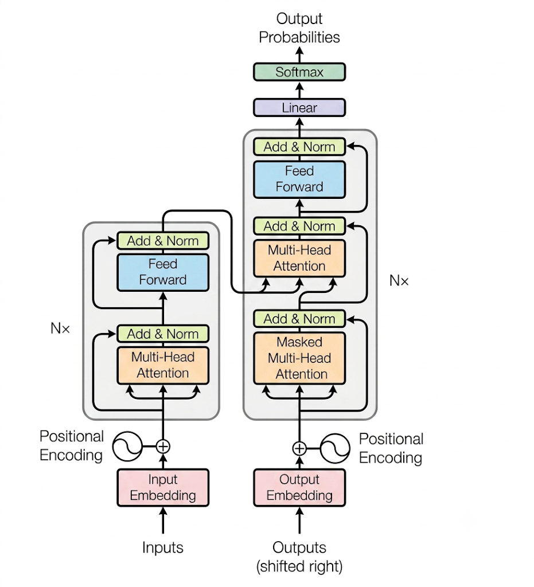
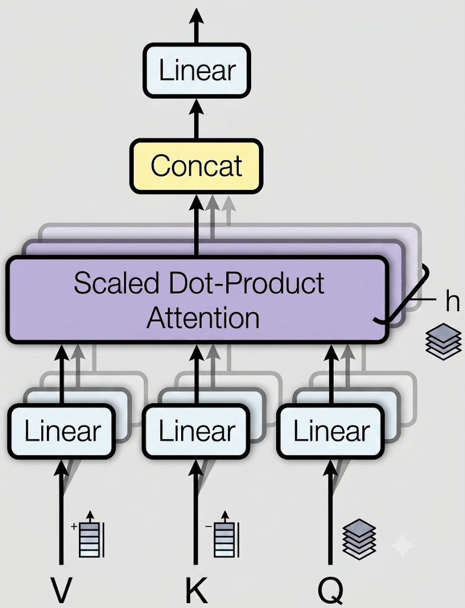

> [!Question] 问题 1：AI 领域的模型大概有多大的词表？
>
> - 2013 年: Word2Vec --- 10000 ～ 15000
> - 2018 年：BERT --- 21128 ~ 35000
> - 2022 年: ChatGPT --- 50000+
> - 2025 年: DeepSeek, Qwen3 --- 20w
> - 2026 年: V4.1, Qwen 3.8, K3 --- 25w 左右

> [!Question] 问题 2: AI 领域的模型大概有多大的 embedding_dim (嵌入维度)》
>
> - 2013 年: Word2Vec --- 200
> - 2018 年: BERT      --- 768
> - 2022 年：ChatGPT --- 1578
> - 2025 年：DeepSeek, Qwen3, GLM-embedding3 --- 2048
> - 2026 年: V4.1, Qwen3.8, K3, GPT-6 Astra, Fable-5.1 --- 2048 ～ 4096

# 1  Transformer 架构图



# 2  Transformer 功能模块拆分

## 2.1  Embeddings

### 2.1.1  Embeddings 实现过程

1. 构造 \__init\__() 方法   

   - 1.1  使用 super 继承 nn.Module 类

   - 1.2  初始化 d_model (单个 token 特征维度)，vocab (词表大小)

   - 1.3  通过调用 nn.Embedding(d_model, vocab) 获得一个词嵌入对象 self.lut

2. 重写实现 forward() 方法

   - 2.1  传入张量 x ，形状为 (batch_size, seq_len) 通过调用 self.lut() 方法得到张量 x 的词嵌入矩阵并数乘 $\sqrt(d_\text{model})$ 后返回，embeddings 后张量形状为 (batch_size, seq_len, d_model)。

### 2.1.2  Embeddings 测试用例

- 通过输入长整形张量 x，形状为 2 x 4

- d_model = 512, vocab = 1000

- x = torch.LongTensor([[999, 2, 423, 0], [491, 999, 1, 221]])

- 经过 embeding 层后得到

```diff
+embr:tensor([[[ 8.7543e+00,  1.1912e+01, -2.2342e+01,  ...,  1.7890e+01,
+         -2.4705e+01, -3.7449e+01],
         [-3.3416e+01, -4.5698e+00,  3.4089e+01,  ..., -2.0454e+01,
           1.5076e+01, -1.7250e+01],
         [ 3.6159e+01, -6.5078e+00, -3.5055e+01,  ...,  7.6353e+00,
           9.6784e+00,  2.9106e+01],
         [-1.5934e-03, -3.5527e+00,  1.2647e+01,  ..., -1.7759e+01,
          -1.6981e+01, -2.1586e+01]],

        [[ 8.5358e+00, -1.1925e+01,  6.5466e+00,  ..., -1.0637e+01,
          -5.7359e+00, -3.9420e+01],
+        [ 8.7543e+00,  1.1912e+01, -2.2342e+01,  ...,  1.7890e+01,
+         -2.4705e+01, -3.7449e+01],
         [ 1.6458e+01,  7.1646e+00, -6.7928e+00,  ...,  1.3819e+01,
          -2.9607e+01,  1.7892e+01],
         [-8.1554e-01, -1.1881e+01,  1.3646e+01,  ..., -3.5161e+01,
          -9.3493e+00,  9.5291e+00]]], grad_fn=<MulBackward0>)
embr.shape:torch.Size([2, 4, 512])
```

> [!Summary] 结论
>
> - 同一个 token，经历 Embedding 处理后，得到的张量一定是一模一样的！！！

## 2.2  Positional Encoding

### 2.2.1  PE 实现过程

1. 构造 \__init\__() 方法

   - 1.1  初始化 d_model（单个 token 特征维度），dropout（随机失活特征解耦），max_len（设置最大句子长度）

   - 1.2  初始化一个位置编码矩阵 pe，它是一个全 0 阵，矩阵的大小是 max_len * d_model

   - 1.3  初始化一个绝对位置矩阵 position，在我们这里，词汇的绝对位置就是用它的索引去表示，首先使用 arange 方法获得一个连续自然数向量，然后再使用 unsqueeze 方法拓展向量维度使其成为矩阵，又因为参数传的是1，代表矩阵拓展的位置，会使向量变成一个max_len x 1 的矩阵（即只有 0 - 4999 的单列索引矩阵）。

   - 1.4  通过以下两个公式计算位置编码

     - $PE_{(\text{pos}, 2i)} = \sin\left(\frac{\text{pos}}{10000^{\frac{2i}{d_{\text{model}}}}}\right)$

     - $PE_{(\text{pos}, 2i+1)} = \cos\left(\frac{\text{pos}}{10000^{\frac{2i}{d_{\text{model}}}}}\right)$

     ```python
     div_term = torch.exp(torch.arange(0, d_model, 2) * -(math.log(10000.0) / d_model))
     pe[:,0::2] = torch.sin(position * div_term)
     pe[:,1::2] = torch.cos(position * div_term)
     ```

   - 1.5  通过以上算式得到位置编码矩阵 pe 后，由于得到的 pe 只是个二维矩阵 shape = [max_lex, d_model]，想要和 embedding 输出的三维张量相加，就必须拓展一个维度，所以这里使用 unsqueeze(0) 拓展维度，得到 pe.shape = [1, max_lex, d_model].

   - 1.6  通过 self.register_buffer('pe', pe) 进行注册，就能在模型保存后重新加载时和模型结构与参数一同被加载，这样既能呆在显存里，又能永久化呆在磁盘里。

2. 重写实现 forward() 方法

   - 2.1  输入 embeddings 后的张量 x ，通过截取 pe 矩阵的对应 x 张量的有效位置，即 (self.pe[:, :x.size(1)]) 与张量 x 求和，并锁死 requires_grad 
   - 2.2  返回处理过的 x 并 dropout 一部分 x 的矩阵参数

### 2.2.2  PE 测试用例

- 通过上一步对 x 的 embeddings 后将得到的结果传入 pe 的 forward 方法，为每个 embeddings 出来的参数添加位置信息

```diff
+embr:tensor([[[ -0.1886, -41.0692,  31.2749,  ..., -10.1375,  31.6959,  19.7539],
           [-32.2548,  -5.2967,  27.3058,  ..., -24.4089, -38.6079,  37.9388],
           [-32.9560, -15.6979, -37.6856,  ...,  -5.2424, -14.8335,  21.6524],
           [-55.8445,   1.8068,  35.7681,  ..., -10.0986,  12.2409,   8.0465]],
  
          [[ 19.9328, -20.1136,  10.5263,  ...,  11.7744,  13.3039, -17.3552],
+         [ -0.1886, -41.0692,  31.2749,  ..., -10.1375,  31.6959,  19.7539],
           [ 18.4595,   6.7253,  15.4780,  ..., -45.8717, -39.6233,  53.5078],
           [ 18.5758,  16.5148, -38.8599,  ..., -20.1222, -16.9191, -15.5482]]],
         grad_fn=<MulBackward0>)
-embr.shape:torch.Size([2, 4, 512])
pe:tensor([[[ -0.2096, -44.5214,  34.7499,  ..., -10.1528,  35.2177,  23.0599],
           [-34.9038,  -5.2849,  31.2529,  ..., -26.0099,  -0.0000,  43.2654],
           [-35.6074, -17.9045,  -0.0000,  ...,  -4.7137, -16.4814,  25.1693],
           [ -0.0000,   0.0000,  40.0146,  ..., -10.1096,  13.6014,  10.0516]],
  
          [[  0.0000, -21.2374,  11.6959,  ...,  14.1938,  14.7821, -18.1725],
           [  0.7254, -45.0322,  35.6631,  ..., -10.1528,  35.2178,  23.0599],
           [ 21.5209,   7.0101,  18.2383,  ..., -49.8575,  -0.0000,  60.5642],
           [ 20.7966,  17.2498,  -0.0000,  ..., -21.2469, -18.7987, -16.1647]]],
         grad_fn=<MulBackward0>)
-pe.shape:torch.Size([2, 4, 512])
```

> [!Summary] 结论
>
> - 由结果可知，embedings 和添加 pe 矩阵信息输出的结果不会改变输入矩阵 x 的形状。

## 2.3  掩码张量

### 2.3.1  padding 掩码实现

- 构造 make_pad_mask() 方法，通过传入参数张量 x 和掩码 pad_idx，通过 x != pad_idx 产生一个布尔张量再使用 unsqueeze(1) 方法去匹配通过 embeddings 后的张量形状，并方便后续将张量 x 中的 pad 值标柱为无意义的填充符 pad，注意力层后续需要注意将其忽略。

### 2.3.2  causal 掩码实现

- 构造 make_causal_mask() 方法，通过传入张量 x 的 size 用于匹配 $Q \cdot K^T$ 后的张量形状

- 构造出原组 causal_shape = (1, size, size)

- 返回一个 causal_shape 形状的下三角布尔张量

### 2.3.3  padding 和 causal 掩码测试用例

- 1  构造一个 tokens

```python
	# 模拟 2 个句子，长度都为 4
    # 句子 1 有一个 pad，句子 2 有两个 pad
    tokens = torch.tensor([
        [101, 205, 308,   0],  # batch 1
        [101, 506,   0,   0]   # batch 2
    ])
```

- 2  经过 padding 和 causal 掩码方法后分别得到：

```zsh
make_pad_mask: 
tensor([[[ True,  True,  True, False]],

        [[ True,  True, False, False]]])
--------------------------------------------------
make_causal_mask: 
tensor([[[ True, False, False, False],
         [ True,  True, False, False],
         [ True,  True,  True, False],
         [ True,  True,  True,  True]]])
```

## 2.4  注意力机制

- 这里使用注意力计算公式：

  - $\text{Attention}(Q, K, V) = \text{Softmax}(\frac{Q \cdot K^T}{\sqrt(d_k)})$

### 2.4.1  Attention 的实现过程

- 1  构造 attention 方法，传入 query, key, value, mask, dropout 参数

- 2  缩放点积注意力机制，通过 query.size(-1) 拿到注意力头的特征维度 d_k

- 3  按照注意力公式，将 query 与 key 的转置求内积，这里面 key 是将最后两个维度 key.transpose(-2, -1) 进行转置，再除以缩放系数根号下d_k，这种计算方法也称为缩放点积注意力计算。

- 4  接着判断是否使用掩码张量， 使用 tensor 的 masked_fill 方法，将掩码张量和 scores 张量每个位置一一比较，如果掩码张量处为 0，则对应的 scores 张量用浮点数据表达的最小值来替换。

  ```python
  scores = scores.masked_fill(mask == 0, torch.finfo(scores.dtype).min)
  ```

- 5  对 scores 的最后一维进行 softmax 操作，使用 F.softmax 方法，第一个参数是 softmax 对象，第二个是目标维度，这样获得最终的注意力张量 p_attn。

- 6  判断 p_attn 是否使用 dropout 进行随机置 0，将 p_attn 传入 dropout 对象中进行“丢弃“处理

- 7  最后，根据公式将 p_attn 与 value 张量相乘获得最终的 query 注意力表示的 attn 张量并返回，同时返回注意力张量 p_attn

### 2.4.2  Attention 测试用例

- 1  构造传入张量

  ```python
      # 输入长整形张量 x，形状为 2 x 4 
      x = torch.tensor([[999, 2, 423, 0], [491, 999, 1, 221]], dtype=torch.long, device=device)
  ```

- 2  得到scores 和 p_attn 以及 attn 张量的结果，其中 pad 部分已经被替换成 -3.4028e+38 的极小数。

  ```zsh
  scores:
   tensor([[[ 1.2652e+04, -2.2313e+02,  5.7496e+01, -3.4028e+38],
           [-2.2313e+02,  1.3411e+04, -1.6770e+01, -3.4028e+38],
           [ 5.7496e+01, -1.6770e+01,  1.3016e+04, -3.4028e+38],
           [-1.8957e+02,  2.5300e+02,  3.6695e+01, -3.4028e+38]],
  
          [[ 1.3653e+04,  1.5858e+02,  3.1787e+01,  3.0800e+02],
           [ 1.5858e+02,  1.2156e+04,  6.2636e+01,  4.1097e+02],
           [ 3.1787e+01,  6.2636e+01,  1.2294e+04, -1.0825e+03],
           [ 3.0800e+02,  4.1097e+02, -1.0825e+03,  1.3133e+04]]],
         device='cuda:0', grad_fn=<MaskedFillBackward0>)
         
  attn:
  tensor([[[  0.0000,   3.0831,  -2.3244,  ...,   7.4603, -23.1181,   0.0000],
           [-25.0574,  19.6165,   0.0000,  ...,   8.6743, -24.4829,   0.0000],
           [ 10.6966,  -4.2733,  39.4360,  ...,  10.4897,  14.8049, -29.0865],
           [-25.0574,  19.6165,   0.0000,  ...,   8.6743, -24.4829,   0.0000]],
  
          [[  5.5045, -34.8108,   2.4205,  ...,  41.0803,  38.8063,  15.7019],
           [-16.0523,   0.0000,  -1.4113,  ...,   7.4603, -23.1180, -19.9249],
           [ 13.9935, -24.1580,  -1.1443,  ...,  -2.2936, -36.2122,   5.6747],
           [  0.0000,  -3.3009,   3.5453,  ...,   3.6434,   0.0000,  46.5649]]],
         device='cuda:0', grad_fn=<UnsafeViewBackward0>)
  attn_shape: torch.Size([2, 4, 512])
  
  p_attn:
  tensor([[[1., 0., 0., 0.],
           [0., 1., 0., 0.],
           [0., 0., 1., 0.],
           [0., 1., 0., 0.]],
  
          [[1., 0., 0., 0.],
           [0., 1., 0., 0.],
           [0., 0., 1., 0.],
           [0., 0., 0., 1.]]], device='cuda:0', grad_fn=<SoftmaxBackward0>)
  p_attn_shape: torch.Size([2, 4, 4])
  ```

## 2.5  多头注意力机制

### 2.5.1  多头注意力架构图



> [!Note] 进行多头注意力的意义
>
> - 大模型都是分布式训练的，需要针对大模型进行 PP, DP, TP, EP, 各种并行计算 --- 多头完全是为了多卡并行计算 + 并行训练来设计的。

### 2.5.2  多头注意力机制实现

1. 构造 \__init\__() 方法   

   - 1.1  使用 super 继承 nn.Module 类

   - 1.2  初始化 head ( 分的多头数 ), d_model (单个 token 特征维度), 

   - 1.3  检测 d_model 被 head 数整除, 得到 embedding_dim/head 个词特征数量

   - 1.4  得到每个头获得的分割词向量维度 d_k

   - 1.5  然后获得线性层对象，通过nn的Linear实例化，它的内部变换矩阵是 embedding_dim x embedding_dim，然后使用 clones 函数克隆四个，因为在多头注意力中，Q，K，V 各需要一个，最后拼接的矩阵还需要一个，因此一共是 4 个。

   - 1.6  最后定义一个空张量 attn，用于后面的前向传播拿到结果

2. 重写实现 forward() 方法

   - 2.1  传入张量 query, key, value 以及掩码张量 mask 没有可置空 ，若存在 mask 则使用 unsqueeze(1) 方法，扩展张量后形状为 (batch_size, 1, 1, seq_len)。

   - 2.2  通过 query.size(0)，拿到 batch_size 的样本大小

   - 2.3  之后进入多头处理环节，首先利用 zip 将输入 QKV 与三个线性层组到一起，然后使用 for 循环，将输入 QKV 分别传到线性层中，做完线性变换后，开始为每个头分割输入，这里使用view方法对线性变换的结果进行维度重塑，多加了一个维度 h，代表头数，这样就意味着每个头可以获得一部分词特征组成的句子，其中的 -1 代表自适应维度，计算机会根据这种变换自动计算这里的值。然后对第二维和第三维进行转置操作，为了让代表句子长度维度和词向量维度能够相邻，这样注意力机制才能找到词义与句子位置的关系，从 attention 函数中可以看到，利用的是原始输入的倒数第一和第二维，这样我们就得到了每个头的输入。

     - 2.3.1  (16, 100, 768).view(16, -1, 12, 64) --- (16, 100, 12, 64) --- 注意：现在变成4维张量了  

     - 2.3.2  (16, 100, 12, 64).transpose(1, 2) --- (16, 12, 100, 64) --- 同一个head的信息要集中在一起‼

   - 2.4  进行多头拼接还原 (batch_size, head, seq_len, d_k) -> (batch_size, seq_len, d_model)

     - 2.4.1  通过多头注意力计算后，我们就得到了每个头计算结果组成的4维张量，我们需要将其转换为输入的形状以方便后续的计算，
     - 2.4.2  因此这里开始进行第一步处理环节的逆操作，先对第二和第三维进行转置，然后使用 contiguous 方法，
     - 2.4.3  这个方法的作用就是能够让转置后的张量应用 view 方法，否则将无法直接使用，
     - 2.4.4  所以，下一步就是使用 view 重塑形状，变成和输入形状相同。

     ```python
     x = x.transpose(1, 2).contiguous().view(batch_size, -1, self.head * self.d_k)
     ```

   - 2.5  最后使用线性层列表中的最后一个线性层，对输入进行线性变换得到最终的多头注意力结构的每一行这一维度（即 dim = -1）进行输出

### 2.5.3  多头注意力机制测试用例

- 1  先 new 一个 mha 对象，然后构造传入张量 x

  ```python
      # 输入长整形张量 x，形状为 2 x 4 
      x = torch.tensor([[999, 2, 423, 0], [491, 999, 1, 221]], dtype=torch.long, device=device)
  ```

- 2  最后得到 self.linears\[-1](x) 结果 torch.Size([2, 4, 512])

  ```zsh
  result_mha:
  tensor([[[  4.0230,  -8.6811,  -5.5465,  ...,   2.7279,   9.5425,   4.8905],
           [  0.8920,   9.7880,   9.6690,  ...,   8.1322,  16.4125, -14.5109],
           [ 10.8571,  -7.3579,   3.0353,  ...,  -2.4479,  -2.7867,  -7.4638],
           [  2.6192,   5.1432,   2.0100,  ...,  18.3379,  -6.7539, -11.9297]],
  
          [[ -2.2253,  -1.1571,  -4.9456,  ...,   1.3123,  -2.9005,   9.3519],
           [ -2.9025, -10.7588,  -2.8629,  ...,   0.4184,   9.5129,  -0.6032],
           [  5.8989,   9.6229,  -9.1961,  ...,  -1.0115,   9.3545,  -8.7252],
           [-10.9296,   0.4983,   9.3730,  ...,   5.0531,   1.0900,  -8.9852]]],
         device='cuda:0', grad_fn=<ViewBackward0>)
  
  result_mha_shape:
   torch.Size([2, 4, 512])
  ```

## 2.6  FeedForward

### 2.6.1  FeedForward 的实现过程

1. 构造 \__init\__() 方法   

   - 1.1  使用 super 继承 nn.Module 类初始化函数有三个输入参数，分别是 d_model，d_ff 和dropout=0.1

   - 1.2  首先按照我们预期使用nn实例化了两个线性层对象，self.w1 和 self.w2，它们的参数分别是 d_model，d_ff 和 d_ff，d_model

   - 1.3  使用 nn 的 Dropout 实例化了对象 self.dropout

2. 重写实现 forward() 方法

   - 2.1  传入张量 x ，首先经过第一个线性层，然后使用 Funtional 中 relu 函数进行激活。
   - 2.2  计算路径: x -> Linear(d_model, d_ff) -> Act -> Dropout -> Linear(d_ff, d_model)

### 2.6.2  FeedForward 测试用例

- 1  先 new 一个 emb, pe, mh_attn 对象，然后构造传入张量 x，然后 new 一个 ff_mha 对象，将张量 x 通过 emb, pe, mh_attn 对象得到的结果传入 ff_mha

  ```python
      # 输入长整形张量 x，形状为 2 x 4 
      x = torch.tensor([[999, 2, 423, 0], [491, 999, 1, 221]], dtype=torch.long, device=device)
      
      result_mha = mh_attn(query=query, key=key, value=value, mask=mask)
      
      ff_mha_result = ff_mha(result_mha)
  ```

- 2  最后得到经过 feedforward 处理后的结果

  ```zsh
   ff_mha_result:
   tensor([[[-2.6422,  1.3622, -3.0925,  ...,  0.5712, -1.6127, -1.1466],
      [-1.9552, -0.0172,  2.3865,  ...,  1.7610, -1.6283,  2.2604],
      [ 2.7770, -1.6918,  0.0102,  ...,  6.0654,  0.3906, -1.2580],
      [ 1.2671, -0.5361, -3.2566,  ...,  1.9529, -1.4473, -0.2192]],
  
     [[-0.2170,  0.5230,  3.4982,  ...,  2.5851, -1.8753, -1.2802],
      [-1.9407,  0.9455, -2.6528,  ...,  2.4375, -1.3333, -1.3865],
      [-0.3770,  1.7632,  0.9710,  ...,  1.9241, -2.9323,  0.0901],
      [-2.0740,  1.1529,  2.8356,  ..., -0.6177, -1.7710, -1.0057]]],
    device='cuda:0', grad_fn=<ViewBackward0>)
  
   ff_mha_result_shape:
   torch.Size([2, 4, 512])
  ```

## 2.7  LayerNorm

### 2.7.1  LayerNorm 的实现过程

1. 构造 \__init\__() 方法   

   - 1.1  使用 super 继承 nn.Module 类初始化函数有 2 个输入参数，分别是 features（特征维度），eps（防止分母除 0 的数值的微小量，一般为 1e-6 或 1e-5）

   - 1.2  构造全 1 全 0 两个张量 gamma 和 beta

2. 重写实现 forward() 方法

   - 2.1  计算传入 forward 方法张量 x 的最后一个维度均值 mean

   - 2.2  计算传入 forward 方法张量 x 的最后一个维度方差 var

   - 2.3  根据标准 LayerNorm 公式给出 x_norm

     ```python
     x_norm = (x - mean) / torch.sqrt(var + self.eps)
     ```

   - 2.4  返回经过仿射变换后的值

     ```python
      return self.gamma * x_norm + self.beta
     ```

> [!Note] 在 LayerNorm 层中需要的一点
>
> - LayerNorm 层中 gamma（全 1 张量） 和 beta（全 0 张量） 会随着反向传播的进行而改变

### 2.7.2  LayerNorm 的测试用例

- 1  先 new 一个 emb, pe, mh_attn 对象，然后构造传入张量 x，然后 new 一个 ln_mha 对象，将张量 x 通过 emb, pe, mh_attn 对象得到的结果传入 ln_mha

  ```python
  # 输入长整形张量 x，形状为 2 x 4 
  x = torch.tensor([[999, 2, 423, 0], [491, 999, 1, 221]], dtype=torch.long, device=device)
  
  result_mha = mh_attn(query=query, key=key, value=value, mask=mask)
  
  ff_mha_result = ff_mha(result_mha)
  ```

- 2  最后得到经过 LayerNorm 处理后的结果

  ```zsh
  ln_mha_result:
  tensor([[[ 0.7880,  1.2124, -0.5235,  ..., -0.4621, -0.7555,  0.1814],
         [ 0.6570, -0.5035,  0.0666,  ...,  0.4994, -0.4541,  0.6017],
         [-1.3286, -1.1952, -0.6860,  ..., -0.1078,  0.0133, -0.8030],
         [-1.2884,  0.7712, -1.3115,  ...,  1.1141,  0.2009,  1.3420]],
  
        [[ 0.9134, -0.6654, -0.3435,  ...,  0.8732, -2.4281, -1.7680],
         [ 0.2251,  1.2132, -0.9460,  ..., -0.6947, -0.4436, -0.5352],
         [ 0.3638, -0.0999,  0.4174,  ..., -1.9987,  1.7440,  1.4986],
         [-0.4376, -2.1913,  1.3277,  ...,  0.2035,  0.2926, -1.5778]]],
       device='cuda:0', grad_fn=<AddBackward0>)
  ln_mha_result_shape:
  torch.Size([2, 4, 512])
  ```

## 2.8  子层连接结构

### 2.8.1  子层连接结构的实现过程

1. 构造 \__init\__() 方法   

   - 1.1  使用 super 继承 nn.Module 类，初始化函数有 2 个输入参数，分别是 size（特征维度），dropout（随意失活神经元）

   - 1.2  new 一个层归一化对象 norm

2. 重写实现 forward() 方法

   - 2.1  计算 forward 方法，传入张量 x 以及 sublayer 对象，param sublayer: 子层函数/模块 (例如 MultiHeadedAttention 或 PositionwiseFeedForward)

     - Pre-LN 计算路径:
       - 2.1.1  对输入 x 进行规范化: self.norm(x)
       - 2.1.2  传入子层计算特征: sublayer(...)
       - 2.1.3  对子层输出做 Dropout: self.dropout(...)
       - 2.1.4  残差跳跃连接: x + ...

     ```python
     return x + self.dropout(sublayer(self.norm(x)))
     ```

### 2.8.2  子层连接结构的测试用例

- 1  先 new 一个 emb, pe 对象，然后构造传入张量 x，然后 new 一个 self_mha 对象，使用 lambda 表达式构造 sublayer 张量，最后 new 一个 sc 对象并传入 emb_pe_result 和 sublayer 得到 sc_result

  ```python
  # 输入长整形张量 x，形状为 2 x 4 
  x = torch.tensor([[999, 2, 423, 0], [491, 999, 1, 221]], dtype=torch.long, device=device)
  
  sublayer = lambda x: self_mha(x, x, x, mask=mask)
  
  sc_result = sc(emb_pe_result, sublayer)
  ```

- 2  最后得到经过 SublayerConnection 处理后的结果

  ```zsh
  sc_result:
  tensor([[[ 1.1979e+01, -6.5092e+00, -1.1969e+01,  ...,  4.2678e+01,
             4.9411e+00, -9.9220e-01],
           [ 6.9966e+00,  5.2853e+01, -3.4289e+00,  ..., -1.1065e+00,
            -3.3021e+01,  4.6126e+01],
           [-1.9172e+01, -1.2190e+01,  9.3659e+00,  ..., -2.0911e+01,
             6.0847e+00, -1.9812e+01],
           [ 5.5302e+01, -4.7626e+00, -3.5725e+01,  ..., -8.3378e+00,
            -2.5156e-02,  1.3976e+00]],
  
          [[ 2.3207e+01, -2.9681e+01, -2.0089e+01,  ..., -2.1253e+00,
            -3.3254e-01, -3.2041e+01],
           [ 1.2944e+01, -7.2342e+00, -1.0728e+01,  ...,  4.2433e+01,
             5.2419e+00, -1.2713e+00],
           [ 2.7201e+01, -1.5938e+01,  4.0827e+01,  ...,  3.7413e+01,
             4.4631e+00,  1.4762e+01],
           [ 2.8477e+01, -3.0385e+01,  1.9749e+01,  ...,  1.4876e+01,
            -5.0019e+00, -4.0574e+01]]], device='cuda:0', grad_fn=<AddBackward0>)
  sc_result_shape:
  torch.Size([2, 4, 512])
  ```

# 3  Transformer 的 Blocks 结构拆分

## 3.1  EncoderBlock

### 3.1.1  EncoderLayer  实现过程

1. 构造 \__init\__() 方法   

   - 1.1  使用 super 继承 nn.Module 类，初始化函数有 4 个输入参数，分别是 size（特征维度），self_attn（自注意力神经网络对象），feed_forward（前馈神经网络对象），dropout_rate（神经元随机失活比率）

   - 1.2  使用 utils.clones_net 中的  clones 方法复制 2 个残差连接层，一个用于自注意力，一个用于前馈神经网络

     ```python
     self.sublayer = clones(SublayerConnection(size, dropout_rate), 2)
     ```

2. 重写实现 forward() 方法

   - 2.1  计算 forward 方法，传入张量 x 以及 mask 张量

   - 2.2   经过自注意力子层 + 残差与归一化

     ```python
     x = self.sublayer[0](x, lambda x: self.self_attn(x, x, x, mask))
     ```

   - 2.3   经过前馈网络子层 + 残差与归一化，并返回

     ```python
     return self.sublayer[1](x, self.feed_forward)
     ```

### 3.1.2  Encoder  实现过程

1. 构造 \__init\__() 方法   

   - 1.1  使用 super 继承 nn.Module 类，初始化函数有 2 个输入参数，分别是 EncoderLayer 对象，N（用于批量复制的独立器件的个数）

   - 1.2  使用 utils.clones_net 中的  clones 方法复制 N 个 EncoderLayer 层

     ```python
     self.layers = clones(layer, N)
     ```

   - 1.3  定义一个 LN 层， Pre-LN 结构在经过 N 层残差累加后，必须在最终输出前进行全局归一化

     ```python
     self.norm = LayerNorm(layer.size)
     ```

2. 重写实现 forward() 方法

   - 2.1  计算 forward 方法，传入张量 x 以及 mask 张量

   - 2.2   数据顺次通过 N 个独立的编码器层

     ```python
     for layer in self.layers:
       x = layer(x, mask=mask)
     ```

   - 2.3   最终归一化输出

     ```python
     return self.norm(x)
     ```

### 3.1.3  EncoderBlock 的测试用例

- 1  先 new 一个 emb, pe, mh_attn, ff 对象

- 2  将张量 x 生成 mask 张量（ padding 填充） 

- 3  将 d_model, mh_attn, ff, dropout_rate 传入 EncoderLayer 对象再传入 Encoder 以及 N 生成 encoder 对象

- 4  之后通过传入张量 x 和 mask 得到经过 EncoderBlock 后的张量 x

  ```python
  # 输入长整形张量 x，形状为 2 x 4 
  x = torch.tensor([[999, 2, 423, 0], [491, 999, 1, 221]], dtype=torch.long, device=device)
  
  encoder = Encoder(
    layer=EncoderLayer(
      size=d_model,
      self_attn=copy.deepcopy(mh_attn), 
      feed_forward=copy.deepcopy(ff), 
      dropout_rate=dropout_rate
    ), 
    N=N
  )
  
  result_encoder = encoder(x=result_pe_emb, mask=mask)
  ```

- 2  最后得到经过 EncoderBlock 处理后的结果

  ```zsh
  result_encoder_block:
  tensor([[[ 0.6173,  0.3233,  1.1466,  ...,  0.4528,  1.6899, -0.8926],
           [ 1.5778,  0.3815, -1.8903,  ...,  1.1316,  0.2971,  0.4444],
           [ 0.2557,  0.2813,  0.3696,  ..., -0.0914, -0.1061,  0.3188],
           [-0.2441,  0.7059, -1.8112,  ..., -0.1944, -0.1989, -1.7852]],
  
          [[-0.0498,  0.9640, -0.7645,  ..., -0.4937,  2.8100, -0.0114],
           [ 0.6316,  0.2233,  1.1708,  ...,  0.4241,  1.6264, -0.9802],
           [ 1.2906, -0.4348, -1.4918,  ..., -2.2196,  1.5210, -0.0611],
           [-1.0919,  0.1167, -2.4847,  ..., -0.7408,  0.6555,  0.2572]]],
         device='cuda:0', grad_fn=<AddBackward0>)
  result_encoder_block_shape:
  torch.Size([2, 4, 512])
  ```

## 3.2  DecoderBlock

### 3.2.1  DecoderLayer 实现过程

1. 构造 \__init\__() 方法   

   - 1.1  使用 super 继承 nn.Module 类，初始化函数有 5 个输入参数，分别是 size（特征维度），self_attn（自注意力神经网络对象），src_attn（注意力神经网络对象），feed_forward（前馈神经网络对象），dropout_rate（神经元随机失活比率）

     - self_attn 和 src_attn 可用深拷贝技术使用相同的一个多头注意力机制后的张量 x

   - 1.2  使用 utils.clones_net 中的  clones 方法复制 3 个残差连接层，一个用于自注意力，一个用于交叉注意力，一个用于前馈神经网络（即 Self-Attn、Cross-Attn、Feed-Forward）

     ```python
     self.sublayer = clones(SublayerConnection(size, dropout_rate), 3)
     ```

2. 重写实现 forward() 方法

   - 2.1  计算 forward 方法，传入张量 x，2 组 mask 张量以及 EncoderBlock 得到的张量结果

   - 2.2   经过自注意力子层 + 残差与归一化

     ```python
     x = self.sublayer[0](x, lambda x: self.self_attn(x, x, x, mask=target_mask))
     ```

   - 2.3   经过注意力子层 + 残差与归一化

     ```python
     x = self.sublayer[1](x, lambda x: self.src_attn(x, m, m, mask=source_mask))
     ```

   - 2.4   经过前馈网络子层 + 残差与归一化，并返回

     ```python
     return self.sublayer[2](x, self.feed_forward)
     ```

### 3.2.2  Decoder 实现过程

1. 构造 \__init\__() 方法   

   - 1.1  使用 super 继承 nn.Module 类，初始化函数有 2 个输入参数，分别是 DecoderLayer 对象，N（用于批量复制的独立器件的个数）

   - 1.2  使用 utils.clones_net 中的  clones 方法复制 N 个 DecoderLayer 层

     ```python
     self.layers = clones(layer, N)
     ```

   - 1.3  定义一个 LN 层， Pre-LN 结构在经过 N 层残差累加后，必须在最终输出前进行全局归一化

     ```python
     self.norm = LayerNorm(layer.size)
     ```

2. 重写实现 forward() 方法

   - 2.1  计算 forward 方法，传入张量 x ，张量 memory 以及 2 组 mask 张量

   - 2.2   数据顺次通过 N 个独立的编码器层

     ```python
     for layer in self.layers:
        x = layer(
        x,
        memory=memory,
        source_mask=source_mask,
        target_mask=target_mask,
     )
     ```

   - 2.3   最终归一化输出

     ```python
     return self.norm(x)
     ```

### 3.2.3  DecoderBlock 测试用例

- 1 先 new 一个 emb, pe, mh_attn, ff 对象，

- 2 将张量 x 生成 src_padding_mask 张量和 tgt_causal_mask（ pad 填充，以及未来遮掩张量），

- 3 然后将 d_model, mh_attn, ff, dropout_rate 传入 EncoderLayer 对象再传入该 EncoderLayer 以及 N 到 Encoder 类中生成 encoder 对象，

- 4 之后通过传入张量 x 和 src_mask ，得到经过 EncoderBlock 后的张量 result_encoder_block，记 result_encoder_block 为 memory，

- 5 将 y、memory 张量, d_model, mh_attn, ff, dropout_rate 以及 2 个 mask 张量共同传入 DecoderBlock 中得到最后输出的 result_decoder_block 张量结果

```python
# 输入长整形张量 x，形状为 2 x 4，模拟英文 
x = torch.tensor([[999, 2, 423, 0], [491, 999, 1, 221]], dtype=torch.long, device=device)

# 输入长整形张量 x，形状为 2 x 4，模拟法文 
y = torch.tensor([[73, 215, 489, 562, 701, 938], [104, 327, 456, 618, 775, 892]], dtype=torch.long, device=device)

# 生成 mask（注意：传入 input_vocab 而不是 pe_emb，并且使用的是 tgt_vocab.size(1)），并且使用 & 来融合 padding 和 causal 的信息
src_padding_mask = make_padding_mask(src_vocab, pad_idx)
tgt_causal_mask = make_causal_mask(tgt_vocab.size(1))  
tgt_mask = tgt_padding_mask & tgt_causal_mask

# new 一个 Encoder 对象并传入 mh_attn 和 ff_mha 对象参数
encoder = Encoder(
    layer=EncoderLayer(
        size=d_model,
        self_attn=copy.deepcopy(mh_attn), 
        feed_forward=copy.deepcopy(ff), 
        dropout_rate=dropout_rate
    ), 
    N=N
)

# new 一个 Decoder 对象并传入
decoder = Decoder(
    layer=DecoderLayer(
        size=d_model,
        self_attn=copy.deepcopy(mh_attn),
        src_attn=copy.deepcopy(mh_attn),
        feed_forward=copy.deepcopy(ff),
        dropout_rate=dropout_rate,
    ),
    N=N,
)

result_decoder_block = \
    decoder(
        x=result_pe_emb_tgt, 
        memory=result_encoder_block, 
        source_mask=src_padding_mask, 
        target_mask=tgt_mask
    )
```

- 6  最后得到经过 DecoderBlock 处理后的结果

```zsh
result_decoder_block:
 tensor([[[ 1.2272e+00, -7.8649e-01,  8.5908e-01,  ...,  1.3306e+00,
          -6.6547e-01, -1.8414e-01],
         [ 4.3898e-01, -8.0277e-01, -7.1765e-02,  ..., -3.0368e-01,
           9.1804e-01,  4.4853e-01],
         [ 1.3109e-01,  8.9384e-03, -1.6033e+00,  ...,  8.2799e-01,
          -1.2201e+00, -7.1192e-01],
         [ 4.8662e-01, -1.6319e-01,  5.4156e-01,  ..., -1.2910e+00,
           1.4267e+00, -2.1636e+00],
         [ 7.0537e-02,  2.5187e-01,  1.0691e+00,  ..., -1.0861e+00,
           1.5133e-01,  4.7633e-01],
         [ 3.8054e-02, -2.7180e+00,  1.2835e+00,  ..., -1.1746e+00,
          -1.5815e+00, -2.0417e-01]],

        [[ 1.1508e-03, -6.8852e-01,  1.5405e+00,  ...,  6.3176e-01,
           8.3588e-01,  3.3723e-02],
         [ 3.1716e+00, -6.4586e-01,  5.5362e-01,  ..., -6.7086e-01,
           6.0580e-02, -1.7294e+00],
         [ 1.5293e-01,  1.6180e-02, -8.1665e-01,  ..., -9.7225e-01,
           1.7978e+00, -2.2440e-01],
         [-1.9618e-01,  1.0638e+00,  7.6767e-02,  ...,  1.5230e-01,
          -7.5312e-01, -1.0734e+00],
         [-2.4685e+00,  2.4050e-03,  2.8222e-01,  ..., -3.3492e-01,
           3.0811e-01,  5.4368e-01],
         [-3.6456e-02, -9.5744e-01, -1.4479e-01,  ...,  3.3945e-01,
           7.4182e-01, -4.1859e-01]]], device='cuda:0', grad_fn=<AddBackward0>)
result_decoder_block_shape:
 torch.Size([2, 6, 512])
```

## 3.3  GeneratorBlock

### 3.3.1  Generator 实现过程

1. 构造 \__init\__() 方法   

   - 1.1  使用 super 继承 nn.Module 类，初始化函数有 2 个输入参数，分别是 d_model（特征维度），vocab_size（词表大小），

   - 1.2  使用 d_model 和 vocab_size 构造一个 Linear 对象

   - ```python
     self.proj = nn.Linear(d_model, vocab_size)
     ```

2. 重写实现 forward() 方法

   - 2.1  计算 forward 方法，传入张量 x

   - 2.2   返回 softmax 结果

     ```python
     return F.log_softmax(self.proj(x), dim=-1)
     ```

### 3.3.2  Generator 测试用例

- 1  将之前通过 DecoderBlock 的张量输入得

  ```zsh
  gen_result:
   tensor([[[-6.3391, -6.8719, -6.1129,  ..., -8.1128, -7.7131, -7.5772],
           [-7.0934, -6.4087, -7.0360,  ..., -7.8715, -7.9573, -8.0566],
           [-6.9072, -8.0198, -7.0774,  ..., -6.9335, -7.4828, -7.3399],
           [-8.1853, -7.6600, -7.0027,  ..., -7.4451, -6.7033, -6.8095],
           [-6.9980, -8.4930, -6.5304,  ..., -5.7111, -7.5036, -7.5300],
           [-6.3742, -7.5474, -6.8780,  ..., -8.0441, -6.3730, -7.2298]],
  
          [[-7.1090, -5.6765, -6.3110,  ..., -7.1553, -8.0331, -7.0236],
           [-5.9052, -7.2270, -6.3156,  ..., -5.9594, -7.0370, -7.3105],
           [-6.2046, -6.4210, -7.1981,  ..., -7.9376, -6.4678, -7.5109],
           [-7.7379, -7.6873, -7.7874,  ..., -6.6405, -7.0883, -6.5372],
           [-7.8709, -7.0445, -7.1724,  ..., -6.6140, -7.0474, -6.4926],
           [-5.9475, -7.4364, -7.3786,  ..., -5.6680, -7.0050, -7.2509]]],
         device='cuda:0', grad_fn=<LogSoftmaxBackward0>)
  gen_result_shape:
   torch.Size([2, 6, 1000])
  ```